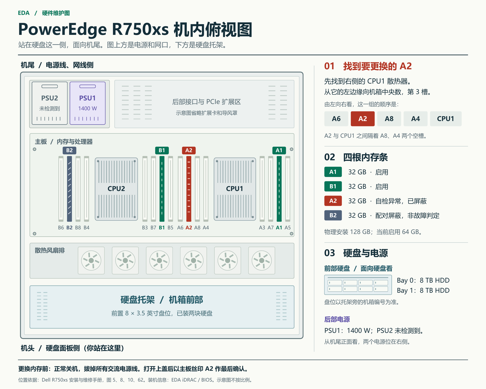

# 服务器一到中高负载，GitLab 就卡：一次从应用到内存通道的排查

我的 GitLab 跑在一台同时承担 FPGA 回归测试的双路 Dell PowerEdge R750xs 上。这台机器轻载时，打开项目页没什么问题；测试任务增多、服务器进入中高负载后，点开项目页经常要等两秒以上，有时连 SSH 都变慢。等负载降下来，访问又恢复了。

我想解决的不是「某个编译工具能开几路」，而是：**同一台服务器在跑计算任务时，怎样让 GitLab 还保持正常响应？**这次最后用原来的四根内存换了两个槽位，恢复了 128 GB；重新施加计算负载后，没有复现之前的明显卡顿。

## 1. 轻载正常，为什么中高负载下会卡？

最初我按 GitLab 自身故障排查，检查了容器健康状态、Puma、数据库和仓库服务。把 GitLab 调整到当时实测更快的 CPU 插槽一侧，网页确实好一些，但负载重新上来时，卡顿还会回来。尤其是网页和 SSH 一起变慢，很难用 Puma 的线程数解释整个现象。

后来把复现过程固定下来：**先暂停计算任务测基线，再施加一种负载，最后停掉负载看是否恢复**。每次探测同一个 GitLab 页面，记录 HTTP 状态和实际耗时。纯 CPU 脚本把整机 CPU 占用推到约 40%，没有稳定复现明显卡顿；Vivado 或布局布线这样的实际任务却能复现。

所以这里讲的「中高负载」，不是说 CPU 超过某个百分比就会卡。计算任务还会访问缓存、内存和磁盘资源；全机平均 CPU 占用率，也不等于 GitLab 所在的 NUMA 节点还有足够余量。清文件缓存曾带来短时改善，但不等于找到了根因。真正值得继续追的是：实测两侧 NUMA 节点表现不同，而且硬件自检有内存告警。

## 2. 自检指向内存，先恢复服务再做对照

这台机器原来是 4 根 32 GB DDR4-3200 ECC RDIMM。iDRAC 的开机自检最初在 A2 记录了 `0x52D2`，提示重新插紧 DIMM。我先屏蔽 A2、B2，只留 A1、B1，用 64 GB 维持服务。但这样跑正式回归，容量很快就会成问题。

接着我在断电后把 A2、B2 的两根内存互换，A1、B1 不动。重启后重新启用两个槽，并等 iDRAC 刷新清单，用序列号确认确实交换了位置。结果不是「A2 不报、B2 报」，而是 **两个槽都出现了新的 `0x52D2`**。开机自检停在 F1 提示，继续启动后系统仍只有 64 GB。

这一步没能把故障单独归到某根条或某个槽。排查时也要分清两件事：BIOS 设置里是 `Enabled`，不代表内存训练通过；iDRAC 记录里有告警，也要核对是不是本次启动新增的。比如此前人为屏蔽时的 `0xA103`，就不能和这轮的 `0x52D2` 混在一起判断。

## 3. 不换内存条，换槽后恢复了 128 GB

图 1：R750xs 内存槽位示意。图中状态是排查时的 64 GB 临时配置，不是最终插法。后来 A1、B1 不动，将 A2、B2 的条分别移到图中标出的 A3、B3。

下一次正常关机并断开电源后，我仍保留 A1、B1 不动，把当时位于 A2 和 B2 的两根分别移到 A3、B3。开机后核对了三处：

- **BIOS：**识别到 128 GB，运行在 3200 MT/s。
- **iDRAC：**A1、A3、B1、B3 各 32 GB，序列号证明搬过去的是原来的两根，本次自检没有新增内存或插法告警。
- **Linux：**两个 NUMA 节点各有两根在线内存，系统可见总量约 125.2 GiB；核对时，四根的可纠正和不可纠正 ECC 错误计数都为 0。

同一批内存搬到另一组槽后能用，原 A2/B2 的槽位、对应通道或接触状况更值得优先查。但重新插拔、重新训练和可用容量恢复都发生在这次操作中，不能据此断定原插槽已经损坏，更不能从一次开机判断具体是哪一项造成了之前的响应变慢。

**这不是 R750xs 的通用插法。**戴尔手册列出的双路四条顺序是 A1、B1、A2、B2，并要求两颗 CPU 的配置匹配。跳过 A2/B2 是这台机器实测可用的临时方案，不保证同型号、不同 BIOS 或不同内存规格的机器也能这样插。参见[戴尔 R750xs 内存安装顺序](https://www.dell.com/support/manuals/en-us/poweredge-r750xs/per750xs_ism_pub/general-memory-module-installation-guidelines?guid=guid-6db30d04-e447-48c6-8748-d6389f356fdb&lang=en-us)。

## 4. 恢复容量后，再看带负载时的 GitLab

开机没报错只是第一步。为了复测「计算任务和 GitLab 同时工作」的场景，我暂停正式回归，起了 16 路 Vivado，用已布线的 checkpoint 做时序分析和生成 bitstream。测试约两分钟。同一台局域网电脑访问同一个项目首页，结果如下：

- **空载基线：**9 次请求，中位数 0.115 秒。
- **并发测试期间：**44 次请求，中位数 0.126 秒，最慢 0.334 秒，全都返回 HTTP 200。
- **恢复正式回归后：**调度器曾达到 20 路；随后在实测 17 路时另做 5 次页面探测，最慢 0.189 秒。

这些是页面 HTTP 请求耗时，不含浏览器渲染。16 路是时序分析和码流生成，不是 16 个大型设计同时从综合跑到布线；而且不能把 17 路时的抽测当作 20 路时的性能数据。能确定的是：**在这几次带真实计算负载的观察里，没有再出现原先那种秒级卡顿。**

## 遇到类似问题，可以按这个顺序排

1. 用同一个页面测轻载和带负载的响应，把卡顿与具体时间、并发数和任务类型对上。
2. 网页和 SSH 一起慢时，除了查 GitLab，也查宿主机的 CPU 等待、内存压力、磁盘等待和 NUMA 差异。不要用一个全机 CPU 占用率下结论。
3. 发现内存告警时，看本次 POST 的事件，记录内存条和槽位；换槽前正常关机、拔电源，换槽后核对 BIOS 容量和 Linux 在线容量。
4. 维护结束后，用之前会触发问题的实际工作负载复测。轻载恢复、开机通过和带负载仍流畅，是三个不同的验收条件。

这次真正有效的做法，是把问题分成两部分验证：先确认机器的内存配置恢复正常，再确认计算任务回到服务器上之后 GitLab 仍能响应。前者靠自检日志和在线容量，后者靠实际页面请求。只看其中一项，都很容易过早宣布问题解决了。
